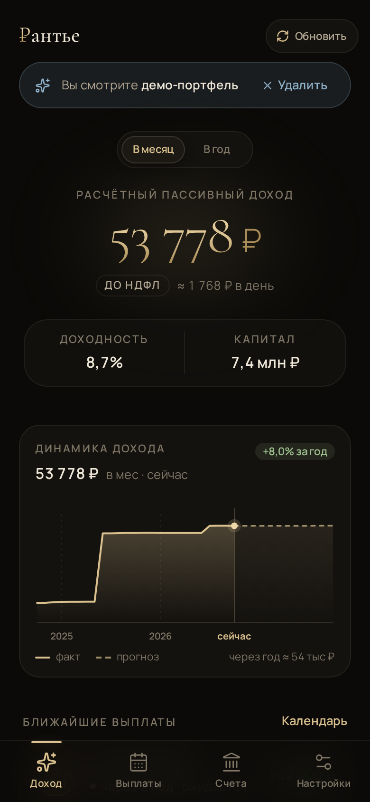
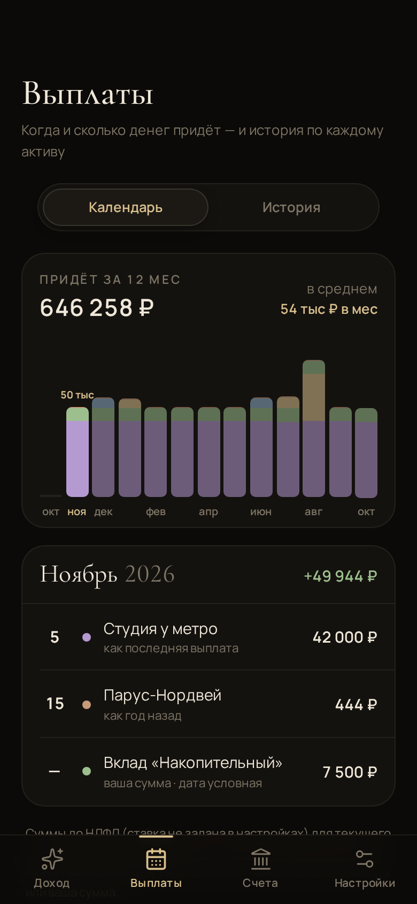
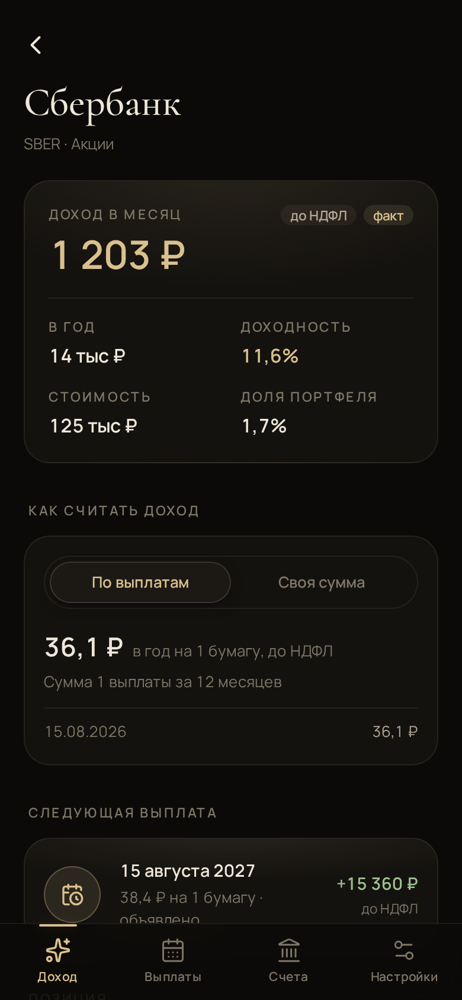

# ₽антье — капитал, который платит

Учёт пассивного дохода. Не котировки и не «плюс-минус за день», а одно число: **сколько денег в месяц приносит ваш капитал** — дивиденды, купоны, аренда и проценты по вкладам вместе.

**Открыть:** https://amchercashin.github.io/heroincome/

<table>
  <tr>
    <td></td>
    <td></td>
    <td></td>
    <td></td>
  </tr>
</table>

## Что умеет

- **Доход в месяц и в год** по всему портфелю, по категориям и по каждой бумаге — с учётом НДФЛ по вашей ставке.
- **Акции, облигации, фонды** — цены и выплаты подтягиваются сами с Мосбиржи и dohod.ru, прогнозы дивидендов тоже.
- **Вклады и недвижимость** — укажите доход в год или записывайте поступления.
- **Календарь выплат** на 12 месяцев вперёд и история дохода: как он рос и каким будет.
- **Импорт отчёта брокера**: отчёт Сбера (HTML) напрямую, любой другой — через ИИ-ассистента по готовому промту.
- **Демо-портфель**, чтобы посмотреть всё без своих данных.

## Кто видит ваш портфель

**Только вы.** У Рантье нет сервера и регистрации. Счета, количество бумаг и суммы хранятся в браузере на вашем устройстве и никуда не отправляются.

- В сеть уходят только тикеры: чтобы узнать цены и дивиденды, приложение спрашивает Мосбиржу и открытые файлы с данными dohod.ru на GitHub — без количества и сумм.
- Импорт через ИИ — по вашему выбору: если отправите отчёт ChatGPT или Claude, его увидит этот сервис. Импорт отчёта Сбера и ручной ввод работают без посредников.
- Раз данные живут только на устройстве, их стоит иногда сохранять: **Настройки → Скачать бэкап**. Приложение само напомнит, если бэкапа давно не было.

## Как поставить на телефон

Рантье — это сайт, который ставится на экран телефона как обычное приложение и работает без интернета.

- **iPhone (Safari):** «Поделиться» → «На экран „Домой“».
- **Android (Chrome):** меню ⋮ → «Установить приложение» или «Добавить на главный экран».

## Какой брокер добавить следующим?

Сейчас напрямую читается отчёт Сбера. Если вам нужен импорт от Т-Инвестиций, ВТБ, Альфы, БКС или Финама — [напишите в Issues](https://github.com/amchercashin/heroincome/issues), каким брокером пользуетесь. Обезличенный пример отчёта (без ФИО и номера договора) очень поможет.

## Для разработчиков

React 19 · React Router 7 · Dexie (IndexedDB) · Tailwind 4 · vite-plugin-pwa · Vitest · Playwright.

```bash
npm install
npm run dev        # локальный сервер
npm run test       # юнит-тесты
npm run test:e2e   # смоук-тесты в мобильном Chrome
npm run build      # сборка в dist/
```

Архитектура, модель дохода и дизайн-система описаны в [CLAUDE.md](CLAUDE.md).
